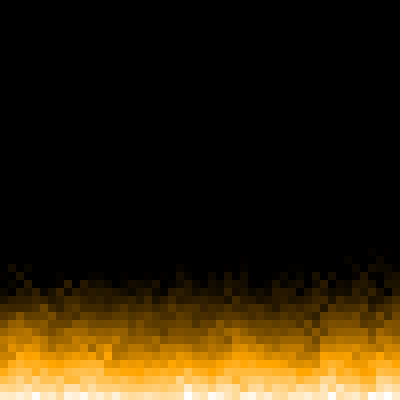

# 🔥 Fire Visualizer

A tiny, fast fire simulation rendered as an animated GIF. The whole thing is one ~25-line script built on NumPy and Pillow.



## Quick start

```bash
pip install -r requirements.txt
python fire.py
```

This writes `fire.gif` (50×50 grid, 30 fps, 3 seconds, 8× upscaled) in about a second.

### Options

| Flag        | Default    | Description                       |
|-------------|------------|-----------------------------------|
| `--size`    | `50`       | Grid width and height (cells)     |
| `--fps`     | `30`       | Frames per second                 |
| `--seconds` | `3`        | Animation length                  |
| `--scale`   | `8`        | Pixels per grid cell in the GIF   |
| `--out`     | `fire.gif` | Output file                       |

```bash
python fire.py --size 80 --seconds 5 --scale 6 --out big_fire.gif
```

## How it works

Each cell holds a heat value from 0 to 100. For every frame:

1. **Fuel row:** the bottom row is set to a random heat of 80 to 100, so the base flickers.
2. **Rise with wind:** going bottom to top, each cell copies the cell below it, shifted left, right or not at all (random per cell), which makes the flames sway.
3. **Cooling:** a random 0 to 5 is subtracted, so heat fades with height.
4. **Temporal smoothing:** the result is blended 90/10 with the same cell in the previous frame, so the fire moves smoothly instead of flickering like static.

Heat is then mapped to a black → orange → white palette.

## Tuning

All values are in the `cur[y] = ...` line and the fuel line of `fire.py`:

| To get...                  | Change                                              |
|----------------------------|-----------------------------------------------------|
| Taller flames              | Lower the decay range, e.g. `rng.integers(0, 4, ...)` |
| Shorter flames             | Raise it, e.g. `rng.integers(0, 8, ...)`            |
| Smoother, slower motion    | Raise the `0.1` previous-frame weight (keep the two weights summing to 1) |
| More flicker               | Lower it                                            |
| More sway                  | Widen the wind range, e.g. `rng.integers(-2, 3, ...)` |

## Why it's fast

- The `x` dimension and all random numbers are vectorized with NumPy, so only rows and frames are looped in Python.
- The GIF is written from a fixed 256-colour palette, so Pillow skips colour quantization.
- Upscaling is done once with `repeat` on the whole array.
- No matplotlib figure and no ffmpeg encode.

## Requirements

Python 3.8+, `numpy`, `pillow`, `matplotlib` (only used to build the colour palette).
